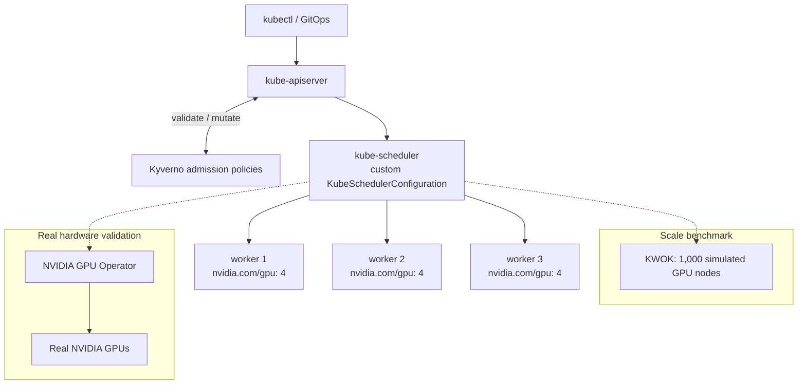

# KubeSchedulerConfiguration

GPU-aware scheduling for Kubernetes, built entirely from configuration.

## Overview

Kubernetes ships with a scheduler designed for general workloads like web services. It places Pods one at a time and, by default, spreads them across nodes so that no single machine gets too busy. That is a sensible choice for stateless services, but it works against GPU workloads such as AI training and batch jobs.

Three problems show up as soon as a cluster runs GPU jobs at scale:

- **Fragmentation.** Small GPU jobs get scattered across many nodes. The cluster may have plenty of free GPUs in total, yet no single node has enough free to run a large job.
- **Partial starts and deadlock.** A distributed training job may need eight Pods running together. The default scheduler can start some of them and then run out of capacity. Those Pods hold expensive GPUs while doing nothing, and two such jobs can block each other indefinitely.
- **Poor placement.** Pods of the same job that communicate constantly can land on distant nodes, racks or zones, slowing the whole job down.

This project addresses those problems by reconfiguring the built-in kube-scheduler and combining it with established open-source tools. The result gives GPU workloads bin-packing, gang (all-or-nothing) scheduling and topology-aware placement. Each configuration is benchmarked on a simulated 1,000-node cluster, and the final setup is validated on a real NVIDIA GPU server running a real CUDA workload.

## Design principles

- **Configuration over code.** There is no forked or custom-written scheduler. Every behaviour comes from declarative configuration kept in this repository: the `KubeSchedulerConfiguration`, the kind cluster definition, Helm values for third-party components and Kyverno policies. Any change to scheduling behaviour is a reviewed change to a file in Git.
- **Upstream first.** The project builds on upstream Kubernetes features, such as the scheduling framework's plugins and the Workload API for gang scheduling, and on CNCF ecosystem tools. Nothing here depends on patching Kubernetes itself.
- **Measured, not assumed.** Every claim about better placement is backed by a reproducible benchmark that compares this setup against the default scheduler and other approaches on the same workloads.

## Architecture

Development runs on a local kind cluster. The control plane's kube-scheduler starts with a custom configuration file mounted from this repository. Worker nodes advertise GPUs as the extended resource `nvidia.com/gpu`; locally these are simulated, and on the GPU server they are real devices reported by the NVIDIA device plugin. Kyverno sits in the admission path and enforces policy on every GPU workload before it reaches the scheduler. For large-scale benchmarks, KWOK simulates up to 1,000 nodes without running real kubelets.



| Component | Role | How it is configured |
| --- | --- | --- |
| kube-scheduler | Places Pods on nodes | `scheduler-config.yaml` (`KubeSchedulerConfiguration`) |
| kind | Local multi-node cluster in Docker | `kind-config.yaml` |
| Fake GPU capacity | Simulates GPUs on local nodes | Node status patch for `nvidia.com/gpu`, scripted |
| GenericWorkload feature gate | Turns on the Workload and PodGroup APIs and the `GangScheduling` plugin (beta, off by default in v1.37) | `featureGates` and `runtimeConfig` (`scheduling.k8s.io/v1beta1`) in `kind-config.yaml` |
| TopologyAwareWorkloadScheduling feature gate | Adds PodGroup `schedulingConstraints.topology`, keeping a group's Pods within one topology domain such as a rack (alpha, off by default in v1.37) | `featureGates` in `kind-config.yaml`; constraints in `manifests/topology/` |
| Workload / PodGroup | Native gang (all-or-nothing) scheduling for multi-Pod jobs | Manifests in `manifests/gang/`; Pods reference a PodGroup with `spec.schedulingGroup.podGroupName` |
| PriorityClasses | `gpu-high` and `gpu-low` order pending gangs and let higher-priority gangs preempt lower-priority work (workload-aware preemption, part of `GenericWorkload` in v1.37) | `manifests/priority/priorityclasses.yaml`; PodGroup `priorityClassName` and `disruptionMode` in `manifests/priority/` |
| Kyverno | Admission-time policy enforcement for GPU workloads in namespaces labelled `gpu-policy=enforced` | Helm chart pinned in `scripts/install-kyverno.sh` with `deploy/kyverno/values.yaml`; `ClusterPolicy` manifests in `policies/` |
| Argo CD | GitOps: keeps Kyverno, the policies, the PriorityClasses and the `ml-team-a` namespace in sync with `main` and reverts changes made by hand | Helm chart pinned in `scripts/install-argocd.sh` with `deploy/argocd/values.yaml`; app of apps in `gitops/`, installed by `scripts/bootstrap-gitops.sh` |
| Volcano or Kueue | Batch and gang scheduling for comparison | Helm values |
| KWOK | Simulates 1,000 GPU nodes for the scale benchmark, in a separate `sched-bench` cluster created by kwokctl with v1.37 control plane components | `benchmarks/kwokctl.yaml` and per-config scheduler settings in `benchmarks/configs/`; nodes and workload created by scripts in `benchmarks/` |
| NVIDIA GPU Operator | Drivers, device plugin, feature discovery and metrics on real hardware | Helm values |

## How it works

For every unscheduled Pod, the scheduler runs two phases. **Filtering** removes nodes that cannot run the Pod, for example because they lack enough free GPUs. **Scoring** ranks the remaining nodes, and the Pod is bound to the highest-scoring one.

By default, the `NodeResourcesFit` plugin scores nodes with the `LeastAllocated` strategy, which favours emptier nodes. On top of that, the default `PodTopologySpread` constraints nudge replicas of the same workload onto different nodes. Together, they spread GPU Pods out.

This project changes the scoring, not the code:

- `NodeResourcesFit` uses the `MostAllocated` strategy, which favours nodes that are already busy. GPUs are weighted ten times more heavily than CPU and memory.
- The score weight of `NodeResourcesFit` is raised so that packing dominates other scoring plugins.
- The default topology spread constraints are cleared, so they no longer pull replicas apart.

The effect, with three nodes of four GPUs each and six Pods that each need one GPU:

```text
Default scheduler (spread)         This configuration (packed)

node 1  [x][x][ ][ ]               node 1  [x][x][x][x]
node 2  [x][x][ ][ ]               node 2  [x][x][ ][ ]
node 3  [x][x][ ][ ]               node 3  [ ][ ][ ][ ]

6 GPUs free, but no node           6 GPUs free, and node 3 can
can run a 4-GPU job                still run a 4-GPU job
```

Later phases add all-or-nothing scheduling for multi-Pod jobs and keep the Pods of one job close together in the cluster topology.

## Results

GPU bin-packing: on a kind cluster with three workers of four fake GPUs each, a Deployment of six 1-GPU Pods was placed 2/2/2 by the default scheduler and 4/2/0 with this configuration. A 4-GPU Pod submitted afterwards stayed Pending with the default scheduler (Insufficient nvidia.com/gpu on every worker) and was Running with this configuration, on the worker the packing left empty. Details and reproduction steps are in [docs/gpu-bin-packing.md](docs/gpu-bin-packing.md).

### Gang scheduling

With 6 of 12 GPUs free, a 4-pod job needing 8 GPUs started 3 Pods and held 6 GPUs without gang scheduling; with a PodGroup of `minCount: 4`, it bound no Pods and held no GPUs. Two such jobs created interleaved on an empty cluster both stalled at 3 of 4 Pods without gang scheduling, while with gang scheduling one job ran all 4 Pods and the other waited, then started once the first was deleted. Details and reproduction steps are in [docs/gang-scheduling.md](docs/gang-scheduling.md).

### Topology-aware placement

With free GPUs spread unevenly across two racks, bin-packing alone placed a 4-pod gang job on the busiest nodes and split it across rack-1 and rack-2. Adding a PodGroup topology constraint on `topology.rack` kept all 4 Pods in rack-1, still packed within the rack. Details and reproduction steps are in [docs/topology-aware-placement.md](docs/topology-aware-placement.md).

### Policy enforcement

With Kyverno v1.19.2 and four policies scoped to namespaces labelled `gpu-policy=enforced`, GPU Pods without a `team` label, containers asking for more than 4 GPUs and `job-type: distributed` Pods without a PodGroup were all rejected with a message saying what to fix, while their correct counterparts were allowed. A PodGroup created without scheduling constraints was stored with a `topology.rack` constraint added. The gang, topology and bin-packing demos gave the same results as before. Details and reproduction steps are in [docs/policy-enforcement.md](docs/policy-enforcement.md).

### Priority and preemption

With a `gpu-high` blocker holding all 12 GPUs, a `gpu-low` gang and then a `gpu-high` gang waited; once the blocker was deleted, the `gpu-high` gang was placed first even though the `gpu-low` gang had been waiting longer. On a cluster where a `gpu-low` gang with `disruptionMode: all` held 8 GPUs, a `gpu-high` gang needing 8 evicted the whole low gang in every run and then started all 4 of its own Pods; plain `gpu-low` Pods without a PodGroup were sometimes evicted only in part (2 of 4 in one run of eight). Details and reproduction steps are in [docs/priority-and-preemption.md](docs/priority-and-preemption.md).

### Scale benchmark

On 1,000 KWOK nodes (8,000 simulated GPUs) with an identical job mix asking for 120% of capacity, median of 3 runs each: the stock scheduler used 85.6% of GPUs, left 1,150 stranded and placed 17 of 60 large 8 × 8-GPU jobs. Bin-packing used 100% of GPUs, stranded none and placed 50, but 4 jobs were left partly placed, holding 62 GPUs. Adding gang scheduling left no job partly placed and placed 51. Adding the rack topology constraint kept all 517 placed multi-Pod jobs within one rack (51% without it) with no fewer jobs placed, at a cost of p99 scheduling latency rising from 2.9 to 5.4 seconds. Details, metric definitions and limitations are in [docs/benchmark.md](docs/benchmark.md).

### GitOps

With Argo CD v3.5.6 managing Kyverno, the four policies, the PriorityClasses and the `ml-team-a` namespace from `main` through an app of apps, it took over the objects already installed by hand in 19 seconds without recreating any of them, and all four policies stayed Ready throughout. A policy deleted with `kubectl` was restored, and a policy message changed by hand was reverted, each within 1 second; a change on a branch reached the cluster 2 seconds after one Application was pointed at it and was gone 1 second after it was pointed back. The policy, gang, topology, preemption and bin-packing demos gave the same results as before. Details and reproduction steps are in [docs/gitops.md](docs/gitops.md).

## Roadmap

| Phase | Goal | Approach |
| --- | --- | --- |
| GPU bin-packing | Eliminate GPU fragmentation | Built-in scheduler, `NodeResourcesFit` with `MostAllocated` weighted on `nvidia.com/gpu` |
| Gang scheduling | Start multi-Pod jobs all at once or not at all | Native Workload API and `GangScheduling` plugin, compared with Volcano or Kueue |
| Topology-aware placement | Keep a job's Pods in the same rack or zone | Node topology labels with affinity and scoring configuration |
| Policy enforcement | Make the rules impossible to bypass | Kyverno policies: GPU limits required, GPU Pods routed to the right scheduler, team labels enforced |
| Scale benchmark | Prove the gains at realistic scale | 1,000 KWOK nodes; throughput, p50 and p99 scheduling latency, GPU fragmentation, gang completion time |
| GitOps | Apply everything declaratively from Git | Argo CD syncing this repository |
| Real hardware validation | Run real GPU workloads under this configuration | k3s or kubeadm with the NVIDIA GPU Operator via Helm, running a CUDA workload |

## Getting started

### Prerequisites

This project is developed on macOS with Apple silicon. Real GPUs are not needed for local development, because GPU capacity is simulated.

Install [Homebrew](https://brew.sh), then the tools:

```bash
brew install --cask orbstack
brew install go kubectl kind helm kwok
```

Open OrbStack once so it starts the container runtime, and point Docker at it:

```bash
open -a OrbStack
docker context use orbstack
docker run hello-world
```

### Create the cluster

The cluster config mounts `scheduler-config.yaml` from an absolute path. If your clone lives somewhere else, update `hostPath` in `kind-config.yaml` first.

```bash
git clone https://github.com/Adityacrypto-del/KubeSchedulerConfiguration.git
cd KubeSchedulerConfiguration
kind create cluster --name sched-dev --config kind-config.yaml
kubectl get nodes
```

You should see one control-plane node and three workers, all `Ready`.

To have Argo CD install Kyverno, the policies, the PriorityClasses and the `ml-team-a` namespace from this repository and keep them in sync, run:

```bash
./scripts/bootstrap-gitops.sh
```

See [docs/gitops.md](docs/gitops.md) for what it manages and how to open the Argo CD UI.

### Clean up

```bash
kind delete cluster --name sched-dev
```

## Repository layout

```text
.
├── scheduler-config.yaml   # KubeSchedulerConfiguration for the built-in scheduler
├── kind-config.yaml        # local cluster: 1 control plane, 3 workers, scheduler config mounted
├── manifests/              # test and example workloads
├── policies/               # Kyverno ClusterPolicies
├── scripts/                # repeatable setup and comparison scripts
├── benchmarks/             # KWOK node templates, workload generators and results
└── docs/                   # per-phase design notes and results
```

## Tested with

| Tool | Version |
| --- | --- |
| Kubernetes (kind node image) | v1.37.0 |
| kubectl | v1.37.1 |
| kind | v0.33.0 |
| Helm | 4.3.1 |
| KWOK | 0.8.0 |
| Go | 1.27.3 |
| Platform | macOS on Apple silicon, OrbStack |
