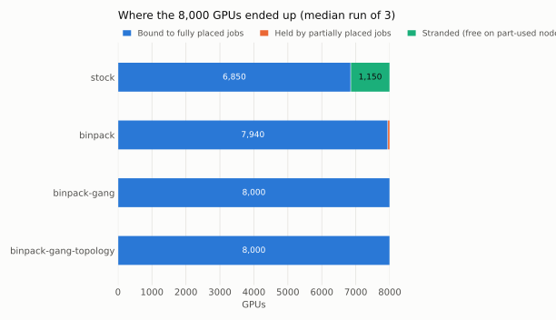
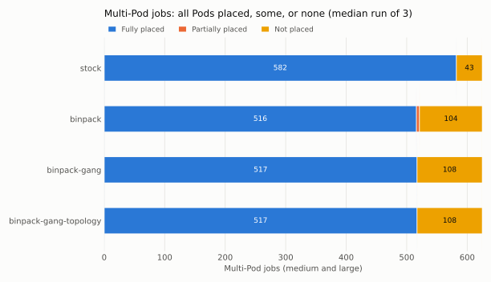

# Scale benchmark

## The question

The earlier results in KubeSchedulerConfiguration come from a kind cluster with 3 workers and 12 fake GPUs. They show each mechanism working, but not what happens at scale, with thousands of Pods competing for more GPUs than exist. This benchmark compares four scheduler configurations on 1,000 simulated GPU nodes (8,000 `nvidia.com/gpu`) under an identical, oversubscribed workload.

Only configuration changes. Every config runs the stock v1.37.0 kube-scheduler; there is no custom scheduler code.

## Setup

| Item | Value |
| --- | --- |
| Cluster | `sched-bench`, created with kwokctl v0.8.0, separate from the `sched-dev` kind cluster |
| Runtime | kwokctl's `docker` runtime, which on this Mac is OrbStack (8 GiB VM, 10 CPUs) |
| Control plane | etcd, kube-apiserver, kube-controller-manager, kube-scheduler and kwok-controller as containers, all Kubernetes v1.37.0 |
| Nodes | 1,000 KWOK nodes, `gpu-node-0001` to `gpu-node-1000`, each with 8 `nvidia.com/gpu`, 96 CPU, 768Gi memory and 110 Pods |
| Topology | 50 racks of 20 consecutive nodes (`topology.rack: rack-01` to `rack-50`); racks alternate `gpu.model: nvidia-h100` and `nvidia-a100` |
| Host | MacBook Air, Apple silicon, 16 GiB memory |

kwokctl settings shared by every config are in [`benchmarks/kwokctl.yaml`](../benchmarks/kwokctl.yaml): the `docker` runtime, `kubeVersion: v1.37.0` (kwokctl v0.8.0 defaults to v1.36.1) and `disableQPSLimits: true`. [`benchmarks/cluster.sh`](../benchmarks/cluster.sh) passes the per-config scheduler config, feature gates and runtime config with `--kube-scheduler-config`, `--kube-feature-gates` and `--kube-runtime-config`.

kube-scheduler ignores kwokctl's `--kube-api-qps` flag when `--config` is set, so it would fall back to 50 qps and 100 burst. `cluster.sh` therefore adds `qps: 5000` and `burst: 10000` to the `clientConnection` of every config before starting the cluster. This is the same for all four, so it does not favour any of them.

KWOK nodes have no kubelet. The kwok-controller keeps them Ready and marks bound Pods Running. Pods never finish, so each run measures how one burst of jobs is packed onto an empty cluster, not a steady state with jobs completing.

## Configurations

Each config is an env file in [`benchmarks/configs/`](../benchmarks/configs/). Configs b to d use the repository's [`scheduler-config.yaml`](../scheduler-config.yaml) unchanged.

| Config | Scheduler config | Feature gates | Multi-Pod jobs |
| --- | --- | --- | --- |
| `stock` | [`stock-scheduler-config.yaml`](../benchmarks/configs/stock-scheduler-config.yaml): default profile (`LeastAllocated`, default topology spread) | none | Plain Pods |
| `binpack` | `scheduler-config.yaml`: `NodeResourcesFit` `MostAllocated`, GPU weight 10, default spread cleared | none | Plain Pods |
| `binpack-gang` | `scheduler-config.yaml` | `GenericWorkload`, plus `scheduling.k8s.io/v1beta1` | A Workload and a PodGroup per job, gang `minCount` = Pod count |
| `binpack-gang-topology` | `scheduler-config.yaml` | `GenericWorkload`, `TopologyAwareWorkloadScheduling`, plus `scheduling.k8s.io/v1beta1` | As above, plus `schedulingConstraints.topology` on `topology.rack` |

## Workload

[`benchmarks/workload.py`](../benchmarks/workload.py) generates a fixed job mix from seed 42. Total GPU demand is 120% of the 8,000 GPUs, split by share between three kinds of job:

| Kind | Shape | Share of demand | Jobs | Pods | GPUs |
| --- | --- | --- | --- | --- | --- |
| small | 1 Pod, 1 or 2 GPUs | 25% | 1,563 | 1,563 | 2,400 |
| medium | 2, 3 or 4 Pods × 2 GPUs | 35% | 565 | 1,681 | 3,362 |
| large | 8 Pods × 8 GPUs (a whole node per Pod) | 40% | 60 | 480 | 3,840 |
| **total** | | | **2,188** | **3,724** | **9,602** |

So 625 jobs have more than one Pod (565 medium and 60 large). Jobs are shuffled, so the three kinds arrive interleaved. Each Pod asks for 4 CPU and 32Gi memory per GPU, a third of a node's per-GPU share, so GPUs are always the scarce resource.

[`benchmarks/run.py`](../benchmarks/run.py) submits the jobs in the same order at 1,000 Pods per second in every config. Job *j* starts at (Pods in jobs before *j*) / 1,000 seconds, and its Pods are created back to back. In the gang configs, a job's Workload and PodGroup are created just before its Pods. Submission takes about 3.7 seconds.

3,724 Pods is within what this MacBook Air handles comfortably. The control plane used about 1 GiB of the 8 GiB OrbStack VM, most of it kube-apiserver, so the benchmark runs at the full scale of 1,000 nodes, with no reduction.

## Metrics

`run.py` watches Pods in the `bench` namespace and records, on the local clock, when each Pod is first seen with `spec.nodeName` set. After the last job is submitted, it waits until no Pod has been bound for 45 seconds, then reads the final Pods and nodes. Results go to `benchmarks/results/<config>/run-<n>/` as `metrics.json`, `metrics.csv` and `pods.csv` (one row per Pod).

| Metric | How it is computed |
| --- | --- |
| Throughput (Pods/s) | Pods bound ÷ (time of the last bind − time the first Pod was submitted) |
| Latency p50, p95, p99 | Per bound Pod: time first seen bound − time its create request was sent, then percentiles with linear interpolation. The `PodScheduled` condition timestamp only has 1-second resolution, so the bind is taken from the watch. |
| Pods bound | Pods with `spec.nodeName` set at the end, out of 3,724 |
| GPU utilisation | GPUs requested by bound Pods ÷ 8,000 |
| Stranded GPUs | Sum of free GPUs on nodes that have between 1 and 7 free. Such a node cannot host an 8-GPU large-job Pod. |
| Multi-Pod jobs fully, partially or not placed | Over the 625 jobs with more than one Pod: all Pods bound, some bound, or none bound |
| GPUs held by partially placed jobs | GPUs requested by the bound Pods of partially placed jobs. These GPUs are allocated but do no useful work, because the job cannot start. |
| Large jobs fully placed | Large jobs (8 × 8 GPUs) with all 8 Pods bound, out of 60 |
| Fully placed multi-Pod jobs within one rack | Of the fully placed multi-Pod jobs, the share whose Pods all have the same `topology.rack` |

The rack metric is reported for every config, not only `binpack-gang-topology`, so the effect of the constraint can be compared with what happens without it.

## Runs

[`benchmarks/bench.sh`](../benchmarks/bench.sh) runs each config 3 times, each on a newly created cluster with newly created nodes. The tables show the median of the 3 runs with the min–max range in brackets; where all 3 runs gave the same value, only one number is shown.

`run.py` checks the wall clock every 0.5 seconds. A gap of more than 5 seconds marks the run as interrupted, and `bench.sh` discards it and runs it again. One run was discarded: the first attempt at `binpack-gang` run 2 had an 89-second clock gap, because the Mac slept. It was repeated, and the repeat is the run reported. Its placement results had matched the other `binpack-gang` runs exactly. All 12 reported runs had a largest clock gap of 0.62 seconds or less, no submit errors and no watch restarts.

## Results

Runs on 25 October 2026 (`stock`, `binpack`, `binpack-gang` run 1) and 27 October 2026 (the rest), with the same scripts and versions. Raw results: [`benchmarks/results/`](../benchmarks/results/). Summary: [`summary.csv`](../benchmarks/results/summary.csv).

| Metric | `stock` | `binpack` | `binpack-gang` | `binpack-gang-topology` |
| --- | --- | --- | --- | --- |
| Throughput (Pods/s) | 434 (394–449) | 523 (463–532) | 512 (450–575) | 360 (350–364) |
| Latency p50 (s) | 2.01 (1.80–2.15) | 1.46 (1.25–1.89) | 1.73 (1.07–2.11) | 3.55 (3.53–3.63) |
| Latency p95 (s) | 3.83 (3.59–4.54) | 2.68 (2.57–3.42) | 2.78 (2.13–3.59) | 5.28 (5.21–5.51) |
| Latency p99 (s) | 3.99 (3.72–4.76) | 2.80 (2.64–3.49) | 2.87 (2.20–3.71) | 5.41 (5.30–5.64) |
| Pods bound (of 3,724) | 3,380 | 3,076 (3,075–3,076) | 3,069 | 3,069 |
| GPU utilisation | 85.6% | 100.0% | 100.0% | 100.0% |
| Stranded GPUs | 1,150 | 0 | 0 | 0 |
| Multi-Pod jobs fully placed (of 625) | 582 | 516 | 517 | 517 |
| Multi-Pod jobs partially placed | 0 | 4 (4–5) | 0 | 0 |
| Multi-Pod jobs not placed | 43 | 105 (104–105) | 108 | 108 |
| GPUs held by partially placed jobs | 0 | 62 (60–64) | 0 | 0 |
| Large jobs fully placed (of 60) | 17 | 50 | 51 | 51 |
| Fully placed multi-Pod jobs within one rack | 0.7% (0.5–0.9%) | 15.1% (14.7–16.1%) | 51.4% (49.1–51.8%) | 100.0% |





The charts show the run with the median GPU utilisation for each config. They are generated by [`benchmarks/summarize.py`](../benchmarks/summarize.py) from each run's `metrics.csv`.

## What the numbers mean

**Bin-packing turns stranded GPUs into placed large jobs.** `stock` spreads Pods across nodes, so after the first burst almost every node has a few GPUs in use. All 1,563 small and 565 medium jobs fit in those gaps, but only 17 of 60 large jobs found 8 empty nodes, and 1,150 GPUs ended up free in pieces no large-job Pod can use. With `MostAllocated`, nodes fill one at a time, whole nodes stay free for large jobs, and 50 to 51 large jobs were placed with every GPU in use.

**More Pods bound is not better here.** `stock` bound the most Pods (3,380) because it placed many small Pods and few large ones. Measured in GPUs, it used 6,850 against 8,000. Demand is 120% of capacity, so in every bin-packing config some jobs had to wait: 285 small jobs, 99 medium jobs and 9 or 10 large jobs.

**Without gangs, some GPUs are held by jobs that cannot start.** With plain Pods, `binpack` left 4 or 5 jobs partly placed in every run, holding 60 to 64 GPUs. Each run had 3 partly placed medium jobs and 1 or 2 partly placed large jobs. Those Pods would sit idle in a real cluster. With `GenericWorkload` and PodGroups, no job was ever partly placed, every one of the 8,000 GPUs went to a complete job, and one more large job was placed (51 instead of 50).

**The topology constraint keeps every job in one rack, without placing fewer jobs.** `binpack-gang-topology` placed exactly the same number of Pods and jobs as `binpack-gang` (3,069 Pods, 517 multi-Pod jobs, 51 large jobs), and all 517 were within one rack. Without the constraint, fully placed large jobs spanned 3.3 racks on average in `binpack-gang` and 7.2 in `stock`.

**Why `binpack-gang` is already 51% within one rack.** It has no rack constraint. In run 1, 257 of its 266 one-rack jobs were medium jobs packed onto a single node: a gang is placed as a group, and `MostAllocated` puts a whole 4- to 8-GPU job onto the same busy node. None of its large jobs was within one rack. So the 51% comes from packing, not from any awareness of racks.

**Topology costs scheduling time.** `binpack-gang-topology` was the slowest config: 360 Pods/s against about 510 for `binpack-gang`, and p99 latency of 5.4 seconds against 2.9. For each PodGroup, the scheduler simulates placing the whole group in each candidate rack before it binds. `binpack` and `binpack-gang` were within each other's run-to-run ranges for throughput and latency, so gang scheduling alone added no measurable overhead at this scale.

## Limitations

- **Simulated nodes.** KWOK nodes have no kubelet, container runtime or devices. The results say where the scheduler placed Pods, not how fast any GPU workload would run there. Real-hardware validation is a later phase.
- **A single burst, no job completions.** Pods never finish, so the benchmark does not show queueing over time, gang completion time, or how fragmentation builds up as jobs come and go.
- **Laptop-scale control plane.** etcd, kube-apiserver and kube-scheduler share one OrbStack VM with 10 CPUs and 8 GiB. Throughput and latency depend on this machine, and production control planes would give different absolute numbers. Compare configs with each other rather than with other clusters.
- **Throughput is capped by the submit rate.** Pods are submitted at 1,000 per second over about 3.7 seconds. Throughput is measured from the first submission to the last bind, so it reflects how quickly the scheduler kept up with this rate, not its peak.
- **Client-side timing.** Latency is measured by the benchmark process from the create request to the first watch event with a node, so it includes API server and watch delivery time. This is the same for all configs.
- **One workload, one seed.** The mix and arrival order are fixed. Other job sizes, rack sizes or arrival patterns could change the margins, for example between `binpack` and `binpack-gang`.
- **No priorities or preemption.** All Pods have priority 0. [Priority and preemption](priority-and-preemption.md) are covered on the kind cluster only.

## Reproduce

See [`benchmarks/README.md`](../benchmarks/README.md). In short, from the repository root:

```bash
benchmarks/bench.sh
```

This runs all four configs 3 times (about 15 minutes; each run takes about a minute including cluster creation), deletes the `sched-bench` cluster and writes the summary and charts. It leaves `sched-dev` and `~/.kube/config` untouched.
